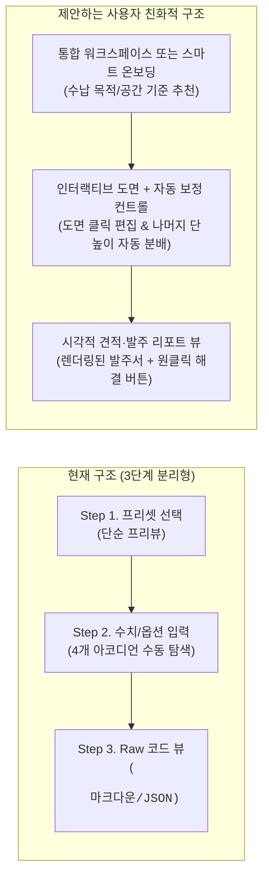

# 원목 선반 사양 컨피규레이터 (`ladakh_shelf`) 기능 전수 검사 및 UX 개선 제안서

`ego-browser`를 활용하여 배포된 **[원목 선반 사양 컨피규레이터 v3.0](https://nitride2bena.github.io/ladakh_shelf/)**의 전 단계(Step 1~3, 헤더 유틸리티, AI 코파일럿, 실시간 SVG 도면 엔진, 구조 검증기, 내보내기)를 실제 브라우저 환경에서 전수 테스트하고 소스 코드([App.tsx](file:///d:/AI/Antigravity/%EA%B3%B5%EC%9C%A0%EC%84%A0%EB%B0%98/src/App.tsx) 외 9개 모듈)와 교차 검증한 결과입니다.

---

## 1. 전체 기능 검사 요약 (Functional QA Matrix)

| 검사 영역 | 세부 기능 항목 | 동작 상태 | 검사 결과 요약 |
| :--- | :--- | :---: | :--- |
| **전역 헤더** | Step 1/2/3 네비게이션 탭 & 완료 체크 아이콘 | ⚠️ 부분 결함 | 단계 이동 및 에러 시 Step 3 차단 작동. 단, **Step 1 복귀 시 현재 편집 중인 사양과 선택 카드가 불일치**함 |
| **전역 헤더** | 글자 크기 3단계 조절 (`작게` / `보통` / `크게`) | ⚠️ 부분 결함 | 루트 `font-size`(`13.5px` / `15px` / `17px`) 변경 작동. 단, `html` 폰트 크기 변경이 `rem` 기반 레이아웃에 영향을 줌 |
| **전역 헤더** | 다크 / 라이트 테마 전환 & API 키 모달 | ⚠️ 부분 결함 | 테마 전환 및 `localStorage` 키 저장 작동. 단, **테마는 새로고침 시 초기화**되며 **SVG 도면은 라이트 모드에서도 다크 고정** |
| **AI 코파일럿** | 자연어 프롬프트 입력 & 공간 사진 첨부 | ⚠️ 부분 결함 | API 미설정 시 로컬 룰 엔진 폴백 작동. 단, **예시 프롬프트 칩이 일반 노트북 화면(`1280px` 미만)에서 숨겨지고**, 로컬 파서에 **모순된 문장 생성 및 정규식 충돌 버그** 존재 |
| **Step 1** | 4종 표준 프리셋 선택 & 실시간 프리뷰 | ❌ 시각 버그 | 카드 전환 및 계산 정상. 단, **한국어 라벨 축약(`.split(' ')[0]`) 오류로 '보강 없음'이 '보강'으로 둔갑**하는 등 심각한 오표기 발생 |
| **Step 1 → 2** | 커스텀 사양 보호(덮어쓰기 확인) 모달 | ❌ 로직 버그 | 다른 프리셋 선택 시에는 경고 모달이 뜨지만, **원본과 동일한 프리셋 카드를 다시 확정하면 경고 없이 커스텀 내역이 즉시 증발**함 |
| **Step 2** | 4대 사양 카드 & 상호 배타적 특주 드로어 | ✅ 정상 | 규격/하부/수종/마감 4개 영역 및 `🛠️ 특주 옵션` 아코디언 개폐, 활성 옵션 도트 표시 정상 (단, 렌치 아이콘 중복 렌더링) |
| **Step 2** | 입력값 클램핑(`ClampedNumberInput`) & 종속성 보정 | ⚠️ UX 미흡 | 범위 외 입력 시 경고 표시 및 `blur` 시 클램핑 정상. 단, **타이핑 중 클램핑된 값이 부모 상태를 즉시 갱신하여 입력 흐름이 끊길 수 있음** |
| **Step 2** | 단별 비대칭 높이 직접 지정 | ⚠️ UX 불편 | 체크박스 활성화 및 합계 불일치 에러 차단 정상. 단, **한 칸의 높이를 수정할 때 나머지 칸 높이를 수동 암산해서 맞춰야만 에러가 풀림** |
| **SVG 도면** | 정면도 + 측면도 실시간 60fps 비례 렌더링 | ❌ 시각 버그 | **상단 타이틀(`정면도`/`측면도`)과 치수(`W`/`D`) 텍스트 겹침**, 광폭 모델에서 **좌측 `H` 치수 텍스트 잘림**, 비대칭 높이 시 **1단 내경만 표시** |
| **Step 3** | `.MD` / `.JSON` / `.SVG` 다운로드, 클립보드 복사, 인쇄 | ⚠️ 부분 결함 | 클립보드 복사 및 파일 다운로드 작동. 단, **Markdown 내 LaTeX 수식(`$H_{\text{clearance}}$`) 노출**, **인쇄 시 600px 스크롤 박스로 인한 내용 잘림** |

---

## 2. 브라우저 실측 캡처 (Visual Evidence)

````carousel

<!-- slide -->

<!-- slide -->

<!-- slide -->

<!-- slide -->

<!-- slide -->

````

---

## 3. 발견된 주요 문제점 및 버그 상세 (Issues & Bugs)

### 🔴 [심각] 시각적·데이터 왜곡 버그

1. **SVG 도면 텍스트 겹침 및 좌측 경계 잘림 ([`BlueprintSVG.tsx`](file:///d:/AI/Antigravity/%EA%B3%B5%EC%9C%A0%EC%84%A0%EB%B0%98/src/components/BlueprintSVG.tsx#L152-L171), [#L496-L533](file:///d:/AI/Antigravity/%EA%B3%B5%EC%9C%A0%EC%84%A0%EB%B0%98/src/components/BlueprintSVG.tsx#L496-L533))**
   - **상단 타이틀과 치수선 충돌:** 높이가 스케일 제한 요인이 되는 대부분의 사양(`h_svg = 240`)에서 `floorY(278) - h_svg(240) = frontTopY(38)`이 됩니다. 이때 가로 치수 텍스트(`W 800mm`)의 Y좌표는 `frontTopY - 14 = 24`가 되어, 상단 타이틀 `정면도 (FRONT VIEW)`(`y = 18`) 및 `측면도 (SIDE VIEW)`(`y = 18`)와 정면으로 겹칩니다.
   - **좌측 `H` 치수 텍스트 잘림:** `오디오/중량물 수납 선반`(`W=1200, H=750`)처럼 가로가 넓은 사양에서는 `w_svg = 280`이 되어 `frontX = 175 - 140 = 35`가 됩니다. 좌측 높이 텍스트(`H 750`)가 `x = frontX - 16 = 19`(`textAnchor="end"`)에 배치되면서 `viewBox="0 0 520 320"`의 좌측 끝(`x = 0`) 바깥으로 넘어가 앞글자 `H`가 잘려 `750`만 보입니다. 또한 다른 치수(`W 800mm`, `D 300mm`, `내경 209mm`, `하부 100mm`)와 달리 `H`만 단위(`mm`)가 누락되어 있습니다.
   - **비대칭 단 높이 지정 시 도면 내경 표기 왜곡:** [`BlueprintSVG.tsx`](file:///d:/AI/Antigravity/%EA%B3%B5%EC%9C%A0%EC%84%A0%EB%B0%98/src/components/BlueprintSVG.tsx#L536-L556)에서 단별 비대칭 높이를 설정해도 우측 첫 번째 칸 치수선에는 해당 칸의 실제 높이가 아니라 전체 평균값(`netShelfHeightMm`)만 표시됩니다.

2. **한국어 라벨 첫 어절 절단(`.split(' ')[0]`)으로 인한 의미 역전 버그 ([`Step1PresetView.tsx`](file:///d:/AI/Antigravity/%EA%B3%B5%EC%9C%A0%EC%84%A0%EB%B0%98/src/components/Step1PresetView.tsx#L128), [#L205-L206](file:///d:/AI/Antigravity/%EA%B3%B5%EC%9C%A0%EC%84%A0%EB%B0%98/src/components/Step1PresetView.tsx#L205-L206), [`Step2ConfigView.tsx`](file:///d:/AI/Antigravity/%EA%B3%B5%EC%9C%A0%EC%84%A0%EB%B0%98/src/components/Step2ConfigView.tsx#L1290-L1299))**
   - 긴 라벨을 줄이기 위해 공백 기준 첫 단어(`.split(' ')[0]`)만 잘라 쓰면서 심각한 정보 왜곡이 발생합니다:
     - `'보강 없음 (기본 판재)'` → **`'보강'`** (보강이 **없는** 기본 프리셋이 오히려 **'보강'**된 것으로 반대 의미로 표시됨)
     - `'북미산 월넛 (호두나무)'` → **`'북미산'`** (수종명인 '월넛'이 사라지고 원산지만 표시됨)
     - `'전통 통장부 맞춤'` → **`'전통'`**, `'전면 원목 에이프런 보강'` → **`'전면'`**, `'하부 스틸 평철 매립 가공'` → **`'하부'`** (핵심 공법 명칭이 모두 잘려나가 `'전통 · 하부'`, `'주먹장 · 전면'`처럼 의미를 알 수 없는 텍스트가 표시됨)

---

### 🟠 [중요] 상태 관리 및 비즈니스 로직 결함

3. **동일 원본 프리셋 재확정 시 커스텀 사양 무단 초기화 버그 ([`App.tsx`](file:///d:/AI/Antigravity/%EA%B3%B5%EC%9C%A0%EC%84%A0%EB%B0%98/src/App.tsx#L103-L111))**
   - `handleConfirmPresetFromStep1`의 보호 조건이 `coreSpec.presetType === 'custom' && coreSpec.basePresetOrigin !== preset.id`로 작성되어 있습니다.
   - 사용자가 `실속형 소프트우드 선반`으로 시작해 Step 2에서 수많은 옵션을 커스텀한 뒤, Step 1로 잠깐 돌아가 그대로 `이 프리셋으로 세부 사양 설정하기 (Step 2)` 버튼을 누르면 `basePresetOrigin === preset.id`이므로 **초기화 경고 모달조차 뜨지 않고 기존의 모든 커스텀 작업이 즉시 삭제**됩니다.

4. **로컬 스마트 폴백 파서(`parsePromptLocally`)의 모순 코멘트 및 정규식 충돌 ([`geminiService.ts`](file:///d:/AI/Antigravity/%EA%B3%B5%EC%9C%A0%EC%84%A0%EB%B0%98/src/services/geminiService.ts#L59-L118))**
   - **자기모순 코멘트:** `"가로 1400 깊이 300 높이 1600 5단 오크 책장"` 입력 시, `'책장'` 키워드 분기에서 먼저 `"화이트오크 24T 두께와 4단 구조...를 설정했습니다"`라는 문장을 추가한 뒤, 아래쪽 `levelMatch`에서 5단으로 덮어쓰며 `"수납 단수를 5단으로 설정했습니다"`를 이어 붙입니다. 결과적으로 한 코멘트 안에 **"4단 구조를 설정했습니다... 수납 단수를 5단으로 설정했습니다"**라는 모순된 문장이 동시에 출력됩니다.
   - **`폭` 키워드 정규식 중복 매칭:** `widthMatch`(`/(?:가로|폭|w)\s*(\d{3,4})/`)와 `depthMatch`(`/(?:깊이|폭|d)\s*(\d{3})/`) 양쪽에 모두 `폭`이 포함되어 있어, 사용자가 `"폭 800"`이라고 입력하면 **가로(`width_mm`)와 깊이(`depth_mm`)가 동시에 `800mm`로 변경**됩니다.
   - **공간 사진 단독 첨부 시 안내 미흡:** API 키가 없는 상태에서 공간 사진만 첨부하거나 사진과 함께 실행하면, 실제로는 사진을 전혀 분석하지 못하는 로컬 텍스트 파서가 돌면서도 사진 분석 실패/API 키 필요 안내가 명확히 분리되지 않습니다.

5. **Gemini API 호출 시 `custom_shelf_heights_mm` 유실 및 모델 하드코딩 ([`geminiService.ts`](file:///d:/AI/Antigravity/%EA%B3%B5%EC%9C%A0%EC%84%A0%EB%B0%98/src/services/geminiService.ts#L195-L206))**
   - Gemini API 응답을 병합할 때 `dimensions` 객체에서 기존 `custom_shelf_heights_mm`를 처리하거나 비대칭 높이 요청을 반영하는 스키마 필드가 없습니다.

---

### 🟡 [보통] UI/UX 및 출력(Export/Print) 사용성 문제

6. **Step 2 비대칭 단 높이 입력의 가혹한 UX ([`Step2ConfigView.tsx`](file:///d:/AI/Antigravity/%EA%B3%B5%EC%9C%A0%EC%84%A0%EB%B0%98/src/components/Step2ConfigView.tsx#L513-L550))**
   - 사용자가 `"1단(맨 아래)에 LP판을 넣기 위해 높이를 340mm로 높이고 싶다"`고 생각하고 1번째 칸을 `210`에서 `340`으로 바꾸는 순간, 전체 유효 내경 합계(`628mm`)와 일치하지 않는다며 **빨간색 구조 오류(Error)가 발생하고 Step 3 진행이 차단**됩니다.
   - 에러를 없애려면 사용자가 직접 암산(`628 - 340 = 288`, `288 / 2 = 144`)하여 나머지 칸의 숫자를 일일이 맞춰야 하며, 또한 UI 라벨이 `"위에서 1번째 단"`부터 시작해 가구 수납에서 흔히 쓰는 `"하단(1단)"` 개념과 혼동을 일으킵니다.

7. **예시 프롬프트 칩 숨김 현상 및 아이콘 중복**
   - [`AICopilotBar.tsx`](file:///d:/AI/Antigravity/%EA%B3%B5%EC%9C%A0%EC%84%A0%EB%B0%98/src/components/AICopilotBar.tsx#L61)에서 예시 프롬프트 칩 컨테이너가 `hidden flex-wrap gap-1.5 xl:flex`로 되어 있어, 뷰포트 가로 폭이 `1280px` 미만인 일반 노트북/창 모드(예: `1268px`)에서는 예시 칩 3개가 아예 보이지 않습니다. Step 2에서는 `compact` 모드라 예시 칩이 완전히 제거되어 있습니다.
   - [`Step2ConfigView.tsx`](file:///d:/AI/Antigravity/%EA%B3%B5%EC%9C%A0%EC%84%A0%EB%B0%98/src/components/Step2ConfigView.tsx#L302-L303)의 4개 카드 특주 버튼에 `<Wrench />` SVG 아이콘과 텍스트 내 이모지 `🛠️`가 중복 사용(`🔧 🛠️ 특주 옵션`)되었습니다.

8. **Step 3 문서 내보내기 및 A4 인쇄 문제 ([`Step3ExportView.tsx`](file:///d:/AI/Antigravity/%EA%B3%B5%EC%9C%A0%EC%84%A0%EB%B0%98/src/components/Step3ExportView.tsx#L84), [#L431-L440](file:///d:/AI/Antigravity/%EA%B3%B5%EC%9C%A0%EC%84%A0%EB%B0%98/src/components/Step3ExportView.tsx#L431-L440))**
   - **Markdown 원본 텍스트 노출 및 LaTeX 코드 혼입:** Step 3 우측 프리뷰가 렌더링된 문서가 아닌 `<pre>` 태그 날것의 Markdown 소스를 보여주며, 84행에 `바닥 유효 높이 ($H_{\text{clearance}}$)`라는 LaTeX 문법이 그대로 들어 있어 일반 사용자에게 암호처럼 보입니다.
   - **A4 인쇄(`window.print()`) 시 사양서 잘림:** `<pre className="custom-scroll max-h-[600px] flex-1 overflow-auto ...">`에는 `.print-only-full` 클래스가 적용되어 있지 않아, A4 인쇄 시 600px 이후의 사양서 내용이 잘리고 스크롤바가 찍힙니다.

---

## 4. 사용자 관점의 친화적인 구조 및 UX 개선 제안

단순 버그 수정을 넘어, **처음 방문한 일반 소비자부터 공방 발주자까지 막힘없이 설계를 완료**할 수 있도록 다음과 같은 구조적 개선을 제안합니다.



### 제안 1. '치수 입력' 중심에서 '수납물·공간' 중심의 직관적 가이드 제공
- **수납물 기준 빠른 배지 제공:** 일반 사용자는 `"단당 유효 내경 209mm"`가 어떤 책이 들어가는 높이인지 직관적으로 알기 어렵습니다. 도면이나 단수 설정 옆에 **수납 가능 기준 가이드 칩**(예: `단행본(210mm)`, `A4/잡지(310mm)`, `LP 바이닐(340mm)`)을 표시하고, 클릭 시 해당 내경이 확보되도록 전체 높이(`H`) 또는 단수(`N`)를 자동 제안하면 훨씬 친화적입니다.
- **슬라이더 + 숫자 입력 병행:** 가로(`W`), 깊이(`D`), 높이(`H`) 입력 시 숫자 타이핑뿐 아니라 **빠른 조절 슬라이더(또는 `-50` / `+50` 스텝 버튼)**를 함께 배치하면 60fps 실시간 도면의 장점을 극대화할 수 있습니다.

### 제안 2. 비대칭 단 높이의 '자동 잔여 높이 분배(Auto-Balance)'와 '핀 고정(Lock)' UX
- 현재처럼 사용자가 각 칸의 합계를 계산기 두드려가며 맞추게 하는 대신:
  - 특정 단(예: 하단 1단)을 `340mm`로 입력해 **고정(🔒 Lock)**하면, **나머지 단들이 남은 유효 내경을 자동으로 균등 분배**하도록 개선합니다.
  - 또는 **`[남은 내경(+40mm) 자동 맞춤]`** 원클릭 버튼을 제공하여 에러 상태에 갇히지 않게 합니다.
  - 단 순서 표기도 `"위에서 1번째 단 (상단)"` ~ `"위에서 N번째 단 (최하단)"`으로 위치를 명확히 병기하고, **SVG 도면의 각 칸에도 실제 개별 내경 치수를 모두 표시**합니다.

### 제안 3. 구조 경고/오류 메시지에 '원클릭 해결(Quick Fix) 액션 버튼' 결합
- 현재는 경고 배지에 *"두께 24T 이상, 하중 보강재(에이프런/평철), 또는 중간 세로 칸막이 추가를 권장합니다"*라고 텍스트만 출력되어, 사용자가 어느 카드의 어느 `🛠️ 특주 옵션` 드로어를 열어야 하는지 찾아 헤매야 합니다.
- 경고 배지 하단에 **`[24T로 변경]`**, **`[스틸 평철 보강 추가]`**, **`[중앙 칸막이 1열 추가]`** 같은 **원클릭 액션 칩**을 제공하면, 목공 지식이 없는 사용자도 즉시 안전한 사양으로 보정할 수 있습니다.

### 제안 4. 양방향 인터랙티브 도면 (Interactive SVG Blueprint)
- 우측 SVG 도면이 단순 출력용에 머물러 있습니다. 도면의 치수(`W 800mm`, `H 800mm`, `하부 100mm`, `노치`)나 선반 판재를 마우스로 호버/클릭하면 **좌측의 해당 설정 카드로 포커스(및 특주 드로어 자동 오픈)** 되도록 연결하면 탐색 비용이 크게 줄어듭니다.
- 라이트 모드 전환 시 도면도 깔끔한 **화이트/청사진(CAD 라이트) 테마**로 연동되도록 개선하면 시인성과 인쇄 품질이 함께 향상됩니다.

### 제안 5. Step 3 발주서의 '시각적 문서 뷰어(Rendered Spec Sheet)' 기본 제공
- 일반 사용자에게 `#`, `**`, `| :--- |`, `$H_{\text{clearance}}$`가 섞인 마크다운 원시 코드(`<pre>`)는 가독성이 떨어집니다.
- Step 3의 기본 탭을 **깔끔하게 스타일링된 HTML 발주서 테이블 뷰(인쇄 화면과 동일한 위지윅 리포트)**로 제공하고, 개발자/연동용으로 `Markdown 원문`과 `JSON Schema` 탭을 보조로 두는 구조가 훨씬 친화적입니다.
- 추가적으로 **URL 쿼리스트링(예: `?spec=...`) 공유** 및 **`localStorage` 자동 임시저장**을 지원하면, 사용자가 설계한 선반 링크를 공방이나 가족에게 바로 카카오톡/링크로 공유할 수 있습니다.
